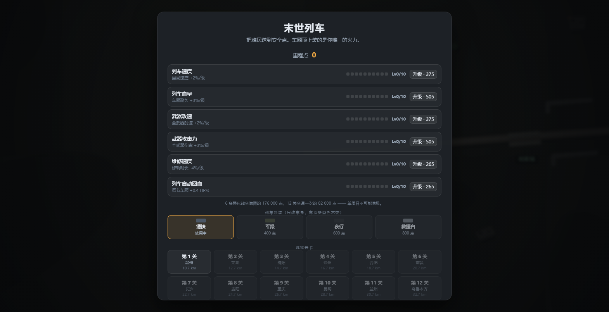
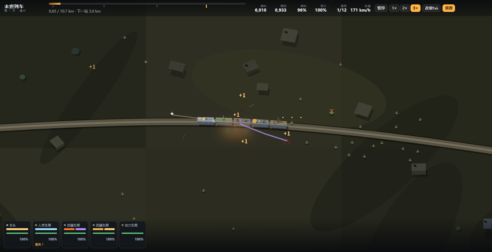

# 末世列车 · The Last Train

> 火车推进 · 车厢编组 · 尸潮防御 —— 一个用原生 JavaScript 写的可玩原型，**零依赖、双击即玩**。

[](./LICENSE)
[](https://github.com/nanji0710/GDD_moshi/actions/workflows/smoke.yml)
[](https://github.com/nanji0710/GDD_moshi/actions/workflows/deploy-cloudflare.yml)
[](./prototype)

**▶ 在线试玩：[last-train-87y.pages.dev](https://last-train-87y.pages.dev)**（Cloudflare Pages，推 `main` 自动部署）
　备用：[GitHub Pages](https://nanji0710.github.io/GDD_moshi/) ｜ 想绑自己的域名？见 [发布指南](docs/发布指南.md)。



## 这是什么

一列末世火车，车顶装武器，一路把孩子和老送到安全点。

- **你操作的不是列车，是编组。** 每 2.0 km 随机三选一获得一节车厢（武器 / 人员 / 动力 / 装甲 / 修理），挂得越多越慢，动力车厢能把速度拉回来。
- **停车只有两种**：站台（安全停靠，全局暂停，点「继续出发」才开走）和撬轨（强制停 15 秒，刷怪 ×2.2，10% 出小 Boss，修满自动出发）。
- **12 关各有变异**：铁桥（丧尸只能沿轨道来）、夜战（能见度 165 m）、隧道（顶灯光池）、连续弯道（山体挡住射界）、雨战（刹车变长、火焰 -30%）、长直道（速度 +20%、迎面冲锋者）。
- **局外 6 条独立强化线**，一次通关拿到的里程点只够点满其中 2 条。



## 快速开始

```
双击 prototype/index.html
```

没有构建、没有 npm install、没有服务器要求。

| 操作 | 键 |
| --- | --- |
| 暂停 / 继续 | `空格` |
| 倍速 | `1` `2` `3` |
| 改装（车厢 / 武器 / 形态） | `Tab` 或点底部车厢条 |
| 技能 | `Q` 紧急制动 · `W` 全弹齐射 · `E` 强制过载 |
| 静音 | `M` |
| 2D / 2.5D 切换 | `T` |
| 显示射程 | `G` |
| 镜头回到列车 | `F` |
| 缩放 / 平移 | 滚轮 / 拖拽 |

## 特性

- **程序化地形**：轨道用弧长参数化，车厢沿曲线排布；2.5D 斜投影，相机跟随。
- **5 种武器 × 10 级 × 2 形态**（Lv3 二选一，Lv4–10 纯数值），5 种开火模式（hitscan / 锥形 / 连发 / 链式 / 迫击）。
- **7 种丧尸 + 精英 + Boss**，导演按关卡密度刷怪，停车时加压。
- **能见度系统**：黑暗层 + 挖洞灯光，车灯、枪口、爆炸、废墟火堆都是光源。
- **程序化音频**：全部 WebAudio 现场合成，无任何音频文件；引擎轰鸣随车速变化。
- **局内存档**：站台 / 停车 / 获得车厢即时落盘，每 15 秒自动存，刷新后「继续上一局」。
- **涂装**：4 款，只改车身不改车顶类型色（保证"一眼认出这是什么车厢"）。

## 目录结构

```
.
├── index.html              跳转页（本地打开用）
├── prototype/              ← 游戏本体（Pages 部署的就是这个目录）
│   ├── index.html
│   ├── css/style.css
│   ├── js/
│   │   ├── cfg.js          全部数值（改数值只改这里）
│   │   ├── state.js        局内状态机 / 车厢 / 武器 / 难民 / 结算 / 存档
│   │   ├── train.js        车厢排布、挂点、开火
│   │   ├── zombies.js      丧尸与刷怪导演
│   │   ├── world.js        程序化地图、轨道、废墟、山体、铁桥
│   │   ├── lighting.js     夜战/隧道/雨水
│   │   ├── sound.js        程序化音频
│   │   ├── meta.js         局外 6 条强化线 + 涂装 + 存档
│   │   ├── save.js         局内存档
│   │   ├── ui.js  main.js  fx.js  skills.js  util.js
│   └── tools/
│       ├── smoke.mjs       60 条断言的冒烟测试（CDP）
│       └── shoot.mjs       截图 + console 报错审计（CDP）
└── docs/                   设计文档（GDD、借鉴报告、灵感、数值）
```

## 开发

测试与截图都走系统 Edge 的 headless 模式 + CDP，**零依赖**：

```bash
cd prototype
node tools/smoke.mjs        # 60 条断言，含存档往返、关卡变异、速度公式
node tools/shoot.mjs        # 出 17 张截图并审计 console 报错
```

## 发布

游戏是纯静态站点（一个 `index.html` + `css/` + `js/`，零构建），推 `main` 会自动发到两个地方：

| 平台 | 触发方式 | 地址 |
| --- | --- | --- |
| **Cloudflare Pages** | `.github/workflows/deploy-cloudflare.yml`（wrangler 直传 `prototype/`） | https://last-train-87y.pages.dev |
| **GitHub Pages** | `.github/workflows/pages.yml` | https://nanji0710.github.io/GDD_moshi/ |

CI 需要两个仓库密钥（Settings → Secrets and variables → Actions）：

| Name | 值 |
| --- | --- |
| `CLOUDFLARE_API_TOKEN` | API 令牌，权限仅 `Account · Cloudflare Pages · Edit` |
| `CLOUDFLARE_ACCOUNT_ID` | 账户 ID（Workers & Pages 页右侧） |

本地手动发一次：`$env:CF_API_TOKEN=...; $env:CF_ACCOUNT_ID=...; pwsh -File tools/deploy-cloudflare.ps1`

`release/last-train-prototype.zip` 是**只含游戏本体**的 60 KB 发布包，可直接拖进 Cloudflare Pages 的 Upload assets。
完整步骤（含绑域名、国内加速取舍）见 [docs/发布指南.md](docs/发布指南.md)。

## 设计文档

| 文档 | 内容 |
| --- | --- |
| [GDD](docs/GDD-末世列车-v1.md) | **权威设计文档**：核心循环、局内 10 大系统、12 关、数值总表、排期、验收标准 |
| [借鉴总览](docs/00-借鉴总览与游戏提案.md) | 底座评估、许可红线、可借鉴清单、技术方案 |
| [玩法评审](docs/design/01-玩法方案评审.md) | 第一版方案的 3 个洞与 54 城地图可行性 |
| [数值落地](docs/design/02-方案修订与数值落地.md) | 已作废的历史版本，仅作数值推导存档 |
| [细节灵感](docs/inspire/00-细节设计灵感.md) | 三个岔路口 + 25 个能马上动手的点子 |
| [同类拆解](docs/inspire/07-同类游戏拆解.md) | Last Train Home / Highfleet / FTL 等 8 个商业游戏 |
| [渲染与镜头](docs/borrow/01-渲染与镜头.md) · [列车与轨迹](docs/borrow/02-列车与轨迹.md) | 技术实现笔记 |
| [数值与节奏](docs/inspire/09-数值与节奏模板.md) · [美术](docs/inspire/10-美术与表现方案.md) | 调参与配色 |

## 许可

代码 MIT（见 [LICENSE](./LICENSE)）。原型**不含**第三方源码、美术或音频；
玩法与技术方案参考了 `city-and-metro` 的公开实现思路，其源码为禁止商用许可，
本项目为独立重写，商用前请自行复核。详见 LICENSE 末尾的「第三方与致谢」。
